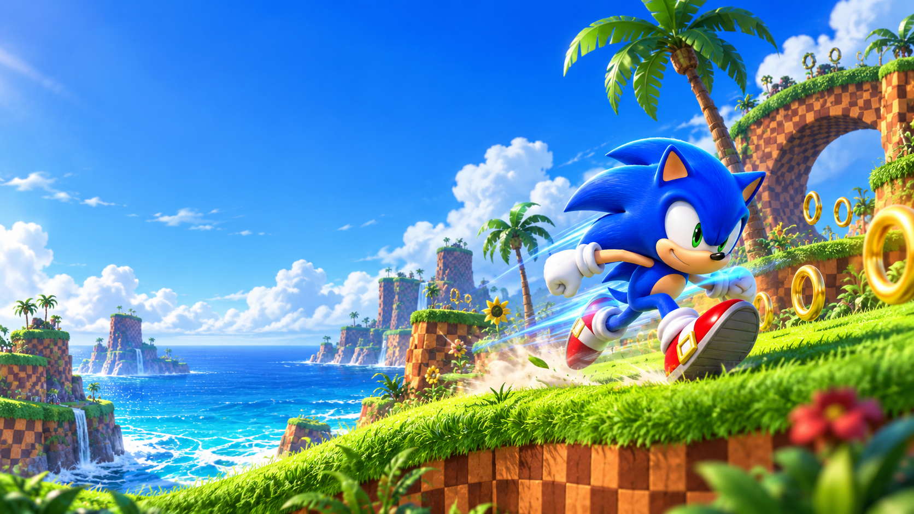
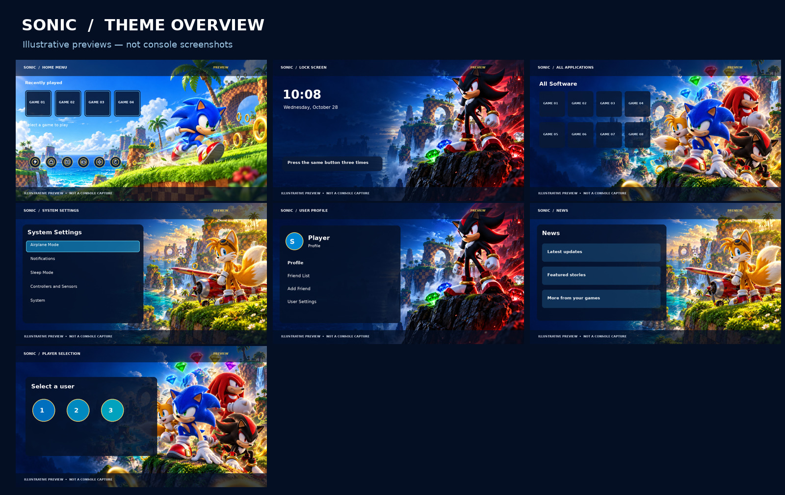
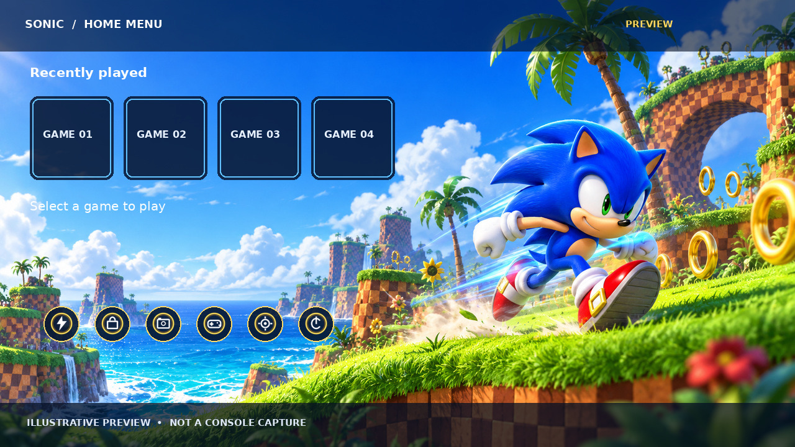
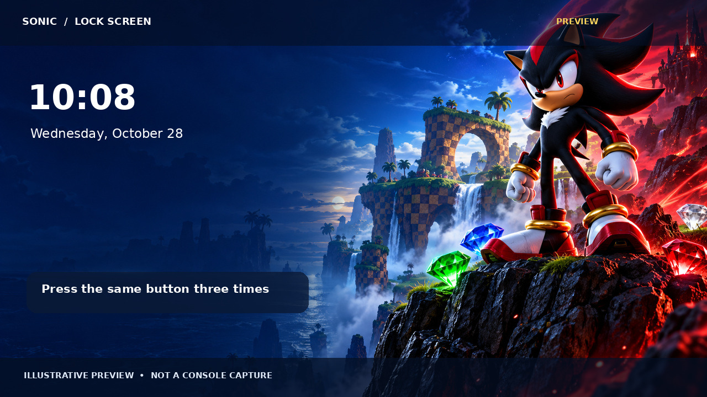
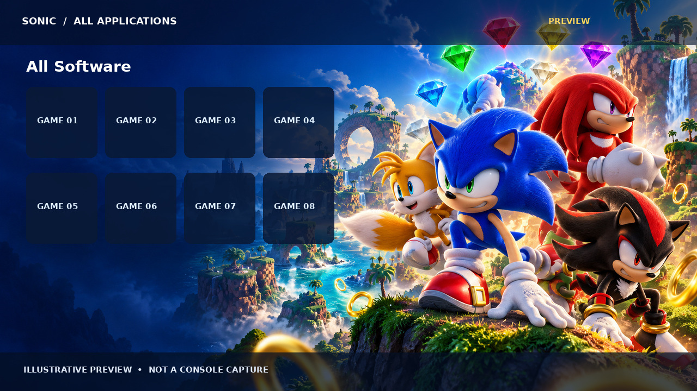
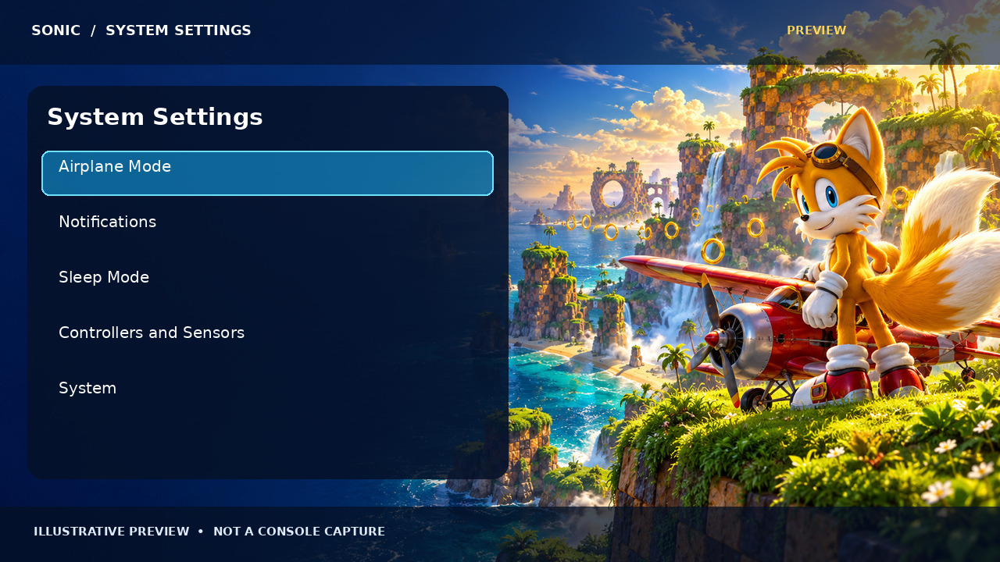
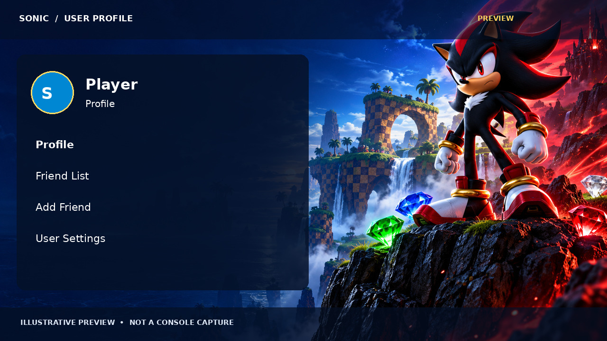
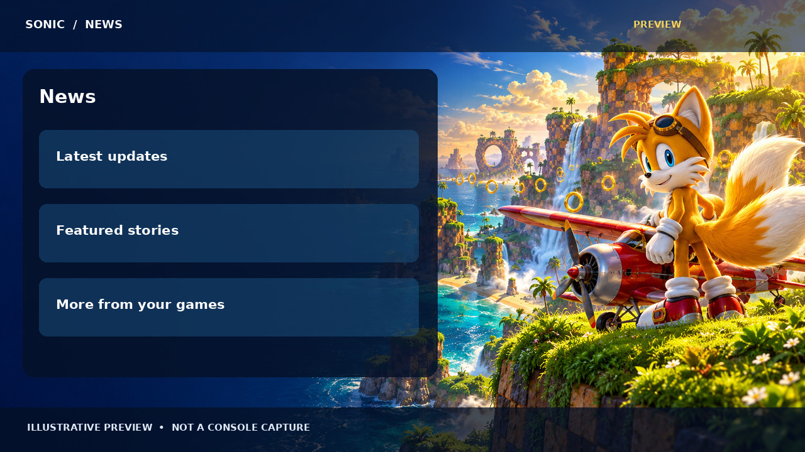
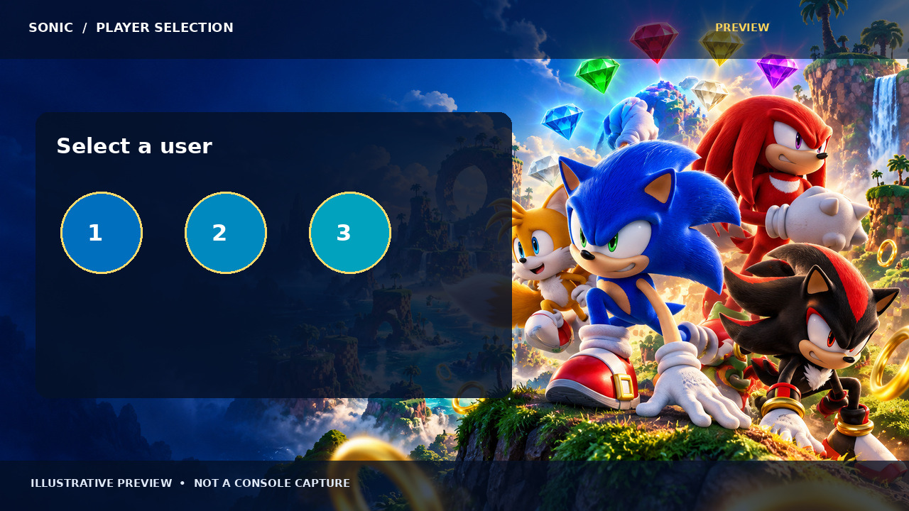

# تم سونیک برای نینتندو سوییچ

**سازنده پروژه: Amir Saeid Dehghan** · [English](README.md)



> **نسخه آزمایشی و در حال توسعه:** این پروژه هنوز یک انتشار نهایی نیست. هفت بسته بررسی پایهٔ ساختار ZIP، اطلاعات و تصویر را گذرانده‌اند؛ اما هنوز با NXThemeTool، برنامهٔ NXThemes Installer یا روی کنسول واقعی تأیید نشده‌اند. بستهٔ صفحهٔ اصلی شش آیکون اختصاصی دارد. از چیدمان پیش‌فرض سیستم استفاده می‌شود و چیدمان اختصاصی و اسکرین‌شات سخت‌افزاری موجود نیست. تصاویر پایین شبیه‌سازی هستند و چیدمان واقعی سیستم را تضمین نمی‌کنند.

این پروژهٔ هواداری با الهام از Green Hill، حلقه‌های طلایی، صخره‌های شطرنجی و شخصیت‌های سونیک ساخته شده است. تصاویر اصلی تولیدشده در پوشهٔ `artwork/` نگهداری می‌شوند و پس‌زمینه‌ها JPEG با ابعاد ۱۲۸۰×۷۲۰ هستند.

## پیش‌نمایش صفحات

**این تصاویر شبیه‌سازی هستند، نه اسکرین‌شات کنسول.** تصاویر از پس‌زمینه‌های بسته‌ها و آیکون‌های صفحهٔ اصلی استفاده می‌کنند، اما پنل‌ها و نوشته‌های شبیه‌سازی‌شده داخل فایل‌های تم نیستند. چیدمان، ظاهر و خوانایی واقعی به نسخهٔ سیستم و تنظیمات آن بستگی دارد.



| صفحه | پیش‌نمایش |
| --- | --- |
| صفحهٔ اصلی |  |
| صفحهٔ قفل |  |
| همهٔ برنامه‌ها |  |
| تنظیمات |  |
| پروفایل |  |
| اخبار |  |
| انتخاب بازیکن |  |

## بخش‌های هدف

| فایل | بخش سیستم |
| --- | --- |
| `packages/sonic-home.nxtheme` | صفحهٔ اصلی |
| `packages/sonic-lock.nxtheme` | صفحهٔ قفل |
| `packages/sonic-apps.nxtheme` | همهٔ برنامه‌ها |
| `packages/sonic-set.nxtheme` | تنظیمات |
| `packages/sonic-user.nxtheme` | پروفایل کاربر |
| `packages/sonic-news.nxtheme` | اخبار |
| `packages/sonic-psl.nxtheme` | انتخاب بازیکن |

## سازگاری و نصب

تم سفارشی به کنسول تغییر‌یافته و سازگار، Atmosphère و NXThemes Installer نیاز دارد؛ کنسول معمولی از این فایل‌ها پشتیبانی نمی‌کند. این بسته‌ها از قالب ZIP نسل جدید استفاده می‌کنند و به نسخهٔ ۳ یا جدیدتر نصب‌کننده نیاز دارند. سازگاری میان نسخهٔ سیستم، Atmosphère و نصب‌کننده را در [پروژهٔ رسمی](https://github.com/exelix11/SwitchThemeInjector/releases) بررسی کنید. **تا پیش از اعتبارسنجی مستقل، این بسته‌ها را انتشار تأییدشده در نظر نگیرید.**

پس از اعتبارسنجی، فایل‌ها را در پوشهٔ `themes/` ریشهٔ کارت microSD کپی کنید، NXThemes Installer را اجرا کنید، بخش‌های موردنظر را انتخاب و مراحل نصب را دنبال کنید، سپس کنسول را راه‌اندازی مجدد کنید. پیش از به‌روزرسانی سیستم تم را حذف کنید. برای خطای بوت به راهنمای بازیابی پروژهٔ رسمی مراجعه کنید و قبل از حذف هر فایل از شناسهٔ صحیح و نسخهٔ پشتیبان مطمئن شوید.

## ساخت و بررسی

Python 3 و Pillow لازم است (`python -m pip install Pillow`). در ریشهٔ پروژه فرمان `python scripts/build.py` را اجرا کنید. اسکریپت تصاویر PNG را به JPEG غیر progressive تبدیل می‌کند و برای هر بخش یک بسته می‌سازد؛ همچنین CRC آرشیو، اطلاعات، ابعاد تصاویر و آیکون‌ها و نوع JPEG را بررسی می‌کند. برای بازسازی آیکون‌ها `python scripts/make_icons.py` و پس از ساخت بسته‌ها برای بازسازی پیش‌نمایش‌ها `python scripts/render_previews.py` را اجرا کنید. این بررسی جایگزین `NxThemeTool validate`، آزمایش نصب، خوانایی رابط یا آزمایش سخت‌افزاری نیست.

برای اعتبارسنجی مستقل یا ساخت چیدمان از [NXThemeTool و NXThemes Installer](https://github.com/exelix11/SwitchThemeInjector) یا [Themezer](https://themezer.net/tools/nxtheme-creator) استفاده کنید. هیچ فایل SZS یا سیستم‌عامل استخراج‌شده‌ای در پروژه توزیع نمی‌شود. چیدمان‌های سفارشی ممکن است به نسخهٔ سیستم وابسته باشند.

## ساختار پروژه

```text
artwork/      تصاویر اصلی تولیدشده
backgrounds/  تصاویر JPEG بسته‌ها در ابعاد ۱۲۸۰×۷۲۰
packages/     بسته‌های آزمایشی تم
icons/        شش آیکون اختصاصی ۶۴×۵۶ صفحهٔ اصلی
previews/     پیش‌نمایش‌های شبیه‌سازی‌شده
scripts/      اسکریپت ساخت، آیکون و پیش‌نمایش
README.md     مستندات انگلیسی
README.fa.md  مستندات فارسی
```

برای شخصی‌سازی، تصاویر اصلی را با حفظ نام جایگزین یا ویرایش و سپس پروژه را بازسازی کنید. کنتراست و خوانایی را روی رابط واقعی بررسی کنید. تصویر بالا اثر هنری است و اسکرین‌شات کنسول نیست.

## اعتبار و حقوق

سازنده: **Amir Saeid Dehghan**. تصاویر برای این پروژهٔ هواداری تولید شده‌اند. حقوق شخصیت‌ها و نشان Sonic متعلق به SEGA و نشان Nintendo Switch متعلق به Nintendo است. این پروژه غیررسمی است و تأیید یا وابستگی رسمی ندارد.
